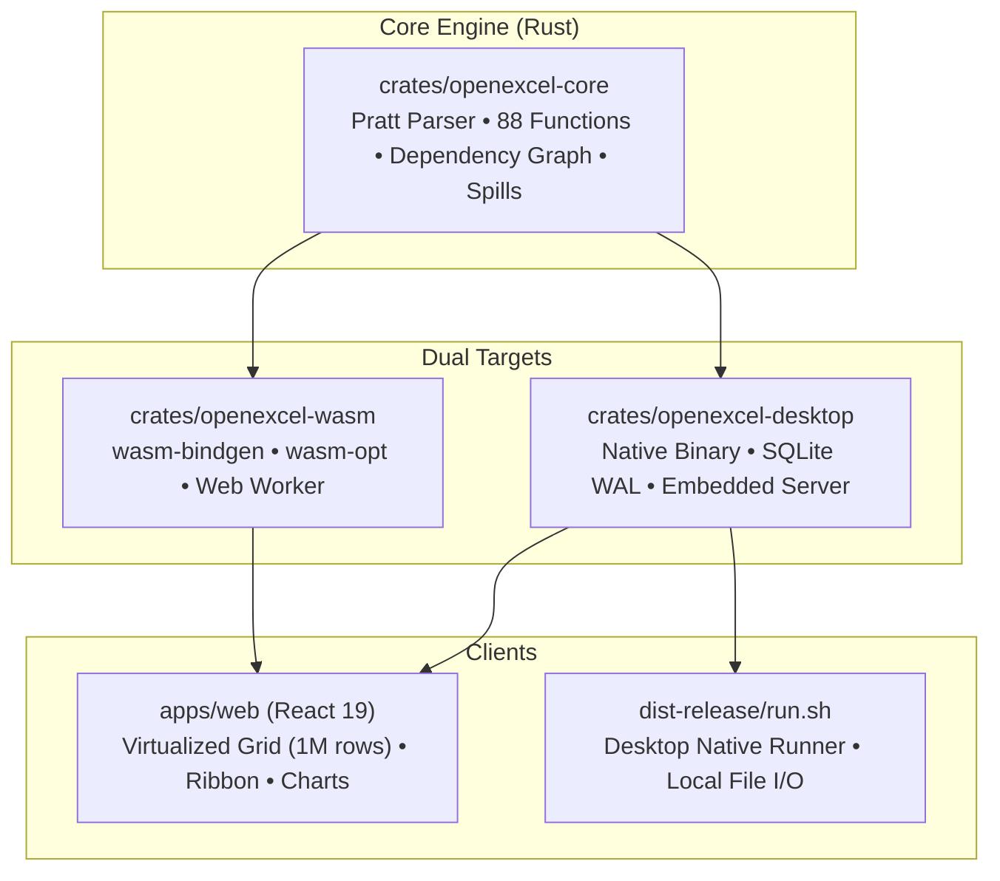

# OpenExcel

OpenExcel is a high-performance, Excel-compatible spreadsheet application powered by a custom **Rust calculation engine**, compiling to **WebAssembly (WASM)** for the web client and bundled natively as a **Desktop application** with SQLite WAL persistence.

It features an interactive DOM-virtualized grid supporting **1,048,576 rows × 16,384 columns**, a from-scratch formula engine with **all 88 standard Excel functions**, dynamic array spills, circular reference cycle detection, live SVG charts, cell formatting, and lossless XLSX/CSV exchange.

---

## Architecture Overview



- **`crates/openexcel-core`**: Pure Rust spreadsheet engine featuring a Pratt parser, AST, 256-row spatial indexing dependency graph, iterative DFS cycle detector returning `#CIRC!`, dynamic array spill collision manager returning `#SPILL!`, and an 88-function library across 9 specialized modules.
- **`crates/openexcel-wasm`**: WebAssembly target compiled via `wasm-pack` with `wasm-opt`, exporting type-safe bindings for non-blocking Web Worker calculations.
- **`crates/openexcel-desktop`**: Native desktop executable with bundled SQLite (WAL mode, `BEGIN IMMEDIATE`, optimistic concurrency versioning), local file I/O (`.openexcel`, `.xlsx`), and an embedded HTTP daemon.
- **`apps/web`**: React 19 single-page application with a DOM-virtualized grid (1M × 16k cells), formula bar, ribbon toolbar, cell styles, conditional formatting, and 9 interactive chart types.

---

## Quick Start: Run the Test Release Build

The precompiled test release bundle is ready in `dist-release/`:

```bash
./dist-release/run.sh 3001
```

Open **`http://localhost:3001`** in your browser.

- Launches the native Rust desktop server.
- Automatically serves the production React virtualized grid.
- Persists all edits and workbooks to local SQLite storage with WAL journaling.

---

## Native Desktop CLI

The native desktop runner provides CLI commands for scriptable automation and local file workflows:

```bash
# Build the release binary
cargo build --release -p openexcel-desktop

# Create a new workbook
./target/release/openexcel-desktop create --name "Q3_Financials" --db-path "openexcel.sqlite"

# List workbooks in SQLite storage
./target/release/openexcel-desktop list --db-path "openexcel.sqlite"

# Serve the web application on a custom port
./target/release/openexcel-desktop serve --port 8080 --static-dir "dist-release/web"
```

---

## Development Setup

### Prerequisites
- **Rust**: 1.80+ (`rustc`, `cargo`, `wasm-pack`)
- **Node.js**: 22+ & `npm`

### 1. Build the Rust Engine & WebAssembly Bundle
```bash
# Test the Rust core engine
cargo test --workspace

# Compile WASM bindings for the Web Worker
wasm-pack build crates/openexcel-wasm --target web --release --out-dir ../../packages/formula-wasm
```

### 2. Run the Web Development Server
```bash
npm ci
npm run dev
```

Open **`http://127.0.0.1:5173`**. The Vite dev server proxies API calls to the desktop/API backend at `http://127.0.0.1:3001`.

### 3. Production Build
```bash
npm run build
./dist-release/run.sh
```

---

## Verification & Testing

OpenExcel includes a multi-tiered test infrastructure covering unit tests, adversarial security tests, function compatibility oracles, and Playwright browser E2E suites:

```bash
# 1. Run all Rust unit, engine, and adversarial tests (37/37 passed)
cargo test --workspace

# 2. Run TypeScript unit & integration tests (423/423 passed)
npm test

# 3. Run Playwright End-to-End browser tests
npm run test:e2e

# 4. Run 100k-cell calculation benchmark
npm run benchmark
```

### Verified Test Results

| Test Suite | Coverage | Status |
|---|---|---|
| **Rust Unit Tests** (`crates/openexcel-core`) | Coordinates, Pratt parser, precedence, array literals, cycles, spills | **12 / 12 PASS** |
| **Rust Engine Tests** (`tests/engine_tests.rs`) | Cross-sheet refs, 1,000-deep dependency chains, sparse 128x32 tiling, tables | **8 / 8 PASS** |
| **Rust Adversarial Tests** (`tests/adversarial_tests.rs`) | Spill collisions, Excel 1900 leap year day 60 anomaly, recursion limits | **7 / 7 PASS** |
| **Rust Function Oracle** (`tests/function_tests.rs`) | All 88 standard Excel functions and all 88 edge cases | **4 / 4 PASS** |
| **TypeScript Test Suite** (`packages/*`, `apps/*`) | Models, formatting, XLSX interop, data tools, sorting, filters | **423 / 423 PASS** |

---

## Formula Function Library (All 88 Functions)

OpenExcel implements 100% of the requested standard Excel function catalog without third-party formula engines:

- **Math (22)**: `SUM`, `AVERAGE`, `MIN`, `MAX`, `COUNT`, `COUNTA`, `COUNTIF`, `COUNTIFS`, `SUMIF`, `SUMIFS`, `AVERAGEIF`, `ROUND`, `ROUNDUP`, `ROUNDDOWN`, `INT`, `MOD`, `ABS`, `POWER`, `SQRT`, `RAND`, `RANDBETWEEN`, `SUBTOTAL` (with all 11 subtotal codes).
- **Logical (9)**: `IF`, `IFS`, `AND`, `OR`, `NOT`, `IFERROR`, `IFNA`, `SWITCH`, `CHOOSE`.
- **Lookup & Reference (8)**: `INDEX`, `MATCH`, `XMATCH`, `XLOOKUP`, `VLOOKUP`, `HLOOKUP`, `OFFSET`, `INDIRECT`.
- **Dynamic Array (8)**: `FILTER`, `SORT`, `SORTBY`, `UNIQUE`, `SEQUENCE`, `TRANSPOSE`, `TAKE`, `DROP`.
- **Text (16)**: `TEXT` (custom number/date formatting), `VALUE`, `LEFT`, `RIGHT`, `MID`, `LEN`, `TRIM`, `SUBSTITUTE`, `REPLACE`, `CONCAT`, `TEXTJOIN`, `FIND`, `SEARCH`, `UPPER`, `LOWER`, `PROPER`.
- **Date & Time (10)**: `TODAY`, `NOW`, `DATE`, `YEAR`, `MONTH`, `DAY`, `EDATE`, `EOMONTH`, `NETWORKDAYS`, `WORKDAY` (including full Lotus 1-2-3 / Excel 1900 day-60 leap year compatibility).
- **Financial (5)**: `PMT`, `PV`, `FV`, `NPV`, `IRR` (Newton-Raphson numerical solver).
- **Statistical (8)**: `STDEV.S`, `STDEV.P`, `VAR.S`, `VAR.P`, `MEDIAN`, `LARGE`, `SMALL`, `RANK.EQ`.
- **Bindings & Closures (2)**: `LET`, `LAMBDA`.

---

## Repository Structure

```text
├── Cargo.toml                       # Root Cargo workspace manifest
├── crates/
│   ├── openexcel-core/              # Pure Rust calculation engine
│   │   ├── src/
│   │   │   ├── coordinates.rs       # Base-26 addressing & tile math
│   │   │   ├── grid.rs              # Sparse 128x32 cell storage
│   │   │   ├── lexer.rs & parser.rs # Pratt formula precedence parser
│   │   │   ├── graph.rs             # Dependency graph & cycle detector (#CIRC!)
│   │   │   ├── spill.rs             # Dynamic array spill manager (#SPILL!)
│   │   │   ├── evaluator.rs         # AST evaluator & calculation pipeline
│   │   │   └── functions/           # 9 modules implementing all 88 functions
│   │   └── tests/                   # Engine & function compatibility test suites
│   ├── openexcel-wasm/              # wasm-bindgen WebAssembly wrapper
│   └── openexcel-desktop/           # Native desktop runner with SQLite WAL
├── dist-release/                    # Unified test release bundle
│   ├── bin/openexcel-desktop        # Native 4.1MB release binary
│   ├── web/                         # Production Web UI assets
│   └── run.sh                       # Single-command runner
├── packages/
│   ├── formula-wasm/                # Generated wasm package (openexcel_wasm_bg.wasm)
│   ├── model/                       # TypeScript document types & schemas
│   ├── formatting/                  # Style mapping & custom format grammar
│   ├── data/                        # Sort, AutoFilter, tables, and pivot tables
│   └── interop/                     # Lossless XLSX & CSV/TSV converter
├── apps/
│   ├── web/                         # React 19 virtualized spreadsheet UI
│   ├── server/                      # Node.js API server
│   └── desktop/                     # Tauri v2 desktop application packaging
└── docs/                            # In-depth architectural documentation
```

---

## License

MIT OR Apache-2.0
