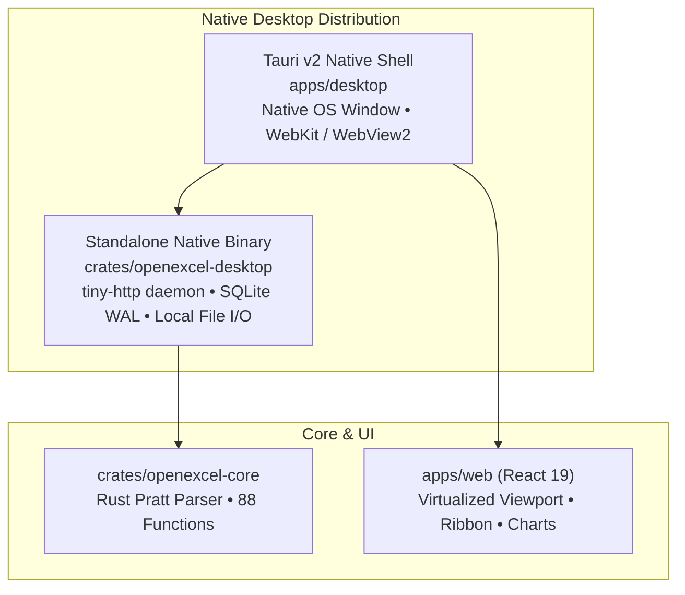

# `apps/desktop` — OpenExcel Desktop Shell Packaging

[](file:///workspaces/excellence-chart/apps/desktop)
[](file:///workspaces/excellence-chart/apps/desktop)
[](file:///workspaces/excellence-chart/dist-release)

Packaging and native shell integration for distributing OpenExcel as a high-performance cross-platform desktop application using Tauri v2 and the native Rust backend.

---

## Desktop Architecture

OpenExcel provides two complementary native desktop distribution models:



1. **Standalone Native Server & Bundle** ([`dist-release/`](file:///workspaces/excellence-chart/dist-release)): A self-contained 4.1MB native binary paired with the precompiled Web UI assets and launch script, requiring zero external runtime dependencies.
2. **Tauri v2 Desktop Shell** ([`apps/desktop/`](file:///workspaces/excellence-chart/apps/desktop)): Embeds the React virtualized interface into native OS window frames using OS webview runtimes (WebKitGTK on Linux, WebKit on macOS, WebView2 on Windows), linked directly to the native Rust calculation engine and SQLite WAL storage.

---

## Configuration (`tauri.conf.json`)

Key configuration specifications in [`tauri.conf.json`](file:///workspaces/excellence-chart/apps/desktop/tauri.conf.json):

- **Window Sizing**: Default resolution of 1280 × 800 with minimum bounds of 800 × 600, allowing smooth scaling on laptops and ultra-wide monitors.
- **Frontend Assets**: Points to `../web/dist` containing the production Vite bundle.
- **Content Security Policy (CSP)**:
  ```text
  default-src 'self'; script-src 'self'; style-src 'self' 'unsafe-inline';
  img-src 'self' data:; connect-src 'self' ws://localhost:*; worker-src 'self' blob:;
  ```
  Permits non-blocking Web Worker instantiation from blob URLs while strictly blocking untrusted external scripts.

---

## Building Desktop Packages

### Prerequisites
- **Rust**: 1.80+
- **Node.js**: 22+
- Platform-specific build tools:
  - **Linux**: `libwebkit2gtk-4.1-dev`, `build-essential`, `curl`, `wget`, `file`, `libssl-dev`, `libgtk-3-dev`, `libayatana-appindicator3-dev`, `librsvg2-dev`
  - **macOS**: Xcode Command Line Tools
  - **Windows**: Visual Studio C++ Build Tools & Microsoft Edge WebView2

### Build Commands

```bash
# 1. Build the production React frontend
npm run build

# 2. Package desktop application with Tauri CLI
npx @tauri-apps/cli build
```

The build produces platform-native installers in `apps/desktop/src-tauri/target/release/bundle/`:
- **Linux**: `.deb` installer and `.AppImage` executable
- **macOS**: `.dmg` disk image and `.app` bundle (universal binary for Apple Silicon & Intel)
- **Windows**: `.msi` Windows Installer and standalone `.exe`

---

## Running in Development Mode

```bash
# Launch native desktop app with live reload
npm run dev --prefix apps/desktop
```
