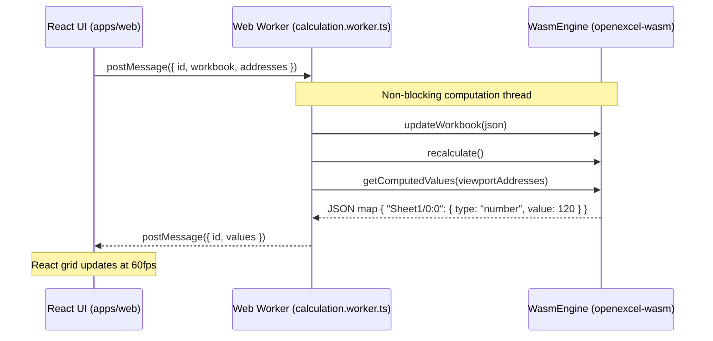

# `openexcel-wasm`

[](file:///workspaces/excellence-chart/crates/openexcel-wasm)
[](file:///workspaces/excellence-chart/crates/openexcel-wasm)
[](file:///workspaces/excellence-chart/crates/openexcel-wasm/tests)

`openexcel-wasm` provides high-performance WebAssembly (WASM) bindings for the [`openexcel-core`](file:///workspaces/excellence-chart/crates/openexcel-core) spreadsheet engine. Compiled using `wasm-pack` and optimized via `wasm-opt`, it bridges safe Rust formula calculation to JavaScript and TypeScript environments with zero-copy operations and non-blocking Web Worker offloading.

---

## Architecture & Worker Integration

In browser spreadsheet applications, formula evaluation and topological graph resolution can saturate the UI thread, causing perceptible frame drops during scrolling or editing. `openexcel-wasm` is architected for asynchronous execution within a dedicated Web Worker (`apps/web/src/calculation.worker.ts`):



---

## Exported API Reference

### Global Functions
- **`init_panic_hook()`**: Activates `console_error_panic_hook`, routing Rust panic backtraces to the browser developer console.
- **`openexcel_version() -> String`**: Returns the version string of the engine (e.g. `"0.1.0"`).
- **`format_address(row: u32, col: u32) -> String`**: Converts zero-indexed row and column coordinates to standard A1 notation (e.g., `row=0, col=0` $\rightarrow$ `"A1"`).

### `WasmEngine` Class
- **`constructor()`**: Initializes an empty engine with a default workbook.
- **`fromJson(json_str: string) -> WasmEngine`**: Factory constructor parsing a serialized workbook.
- **`updateWorkbook(json_str: string)`**: Loads or updates the active workbook state. Automatically accepts both camelCase TypeScript wire formats and snake_case Rust structures.
- **`recalculate() -> WasmRecalcResult`**: Executes topological dependency recalculation. Returns stats `{ recalculatedCount: number, durationMs: number, cycleCount: number, spillCount: number }`.
- **`recalculateJson() -> string`**: Recalculates and returns results as serialized JSON.
- **`getComputedValues(addresses_json: string) -> string`**: Queries computed values for an array of addresses (`[{ sheetId, row, col }]` or keys `["Sheet1/0:0"]`). Returns `{ [addressKey]: ComputedValue }`.
- **`evaluateFormula(sheetId: string, row: number, col: number, formula: string) -> string`**: Evaluates an ad-hoc formula string in the context of the active workbook.

---

## Build Instructions

Compile the WebAssembly target to `packages/formula-wasm/`:

```bash
# Debug build (unoptimized)
wasm-pack build crates/openexcel-wasm --target web --out-dir ../../packages/formula-wasm

# Release build (optimized with wasm-opt -O)
wasm-pack build crates/openexcel-wasm --target web --release --out-dir ../../packages/formula-wasm
```

The build emits:
- `openexcel_wasm_bg.wasm`: Optimized WebAssembly binary (~180KB).
- `openexcel_wasm.js`: ES module loader and wasm-bindgen glue code.
- `openexcel_wasm.d.ts`: TypeScript type definitions.

---

## TypeScript Usage Example

```typescript
import initWasm, { WasmEngine, format_address } from 'openexcel-wasm';

// 1. Initialize WASM module
await initWasm();

// 2. Instantiate calculation engine
const engine = new WasmEngine();

// 3. Load workbook data
const workbook = {
  id: "wb_1",
  sheets: [{
    id: "Sheet1",
    name: "Sheet1",
    cells: {
      "0,0": { input: { raw: "50" } },
      "0,1": { input: { raw: "=A1 * 2", formula: "=A1 * 2" } }
    }
  }]
};
engine.updateWorkbook(JSON.stringify(workbook));

// 4. Recalculate
const stats = engine.recalculate();
console.log(`Recalculated ${stats.recalculatedCount} cells`);

// 5. Query viewport cells
const valuesJson = engine.getComputedValues(JSON.stringify([
  { sheetId: "Sheet1", row: 0, col: 1 }
]));
const values = JSON.parse(valuesJson);
console.log("B1 computed value:", values["Sheet1/0:1"]);
// Output: { type: "number", value: 100 }
```

---

## Running Tests

Integration tests run natively using cargo:

```bash
cargo test -p openexcel-wasm
```

Verifies:
- `test_wasm_engine_lifecycle_and_basic_formulas`: Core instantiation and calculation.
- `test_update_workbook_camel_case_ts_model`: Wire format schema compatibility.
- `test_dynamic_array_spill_and_collision`: Array spill handling over WASM boundary.
- `test_circular_reference_detection`: `#CIRC!` resolution across WASM bridge.
- `test_standard_excel_functions_suite`: 88-function verification through WASM interface.
