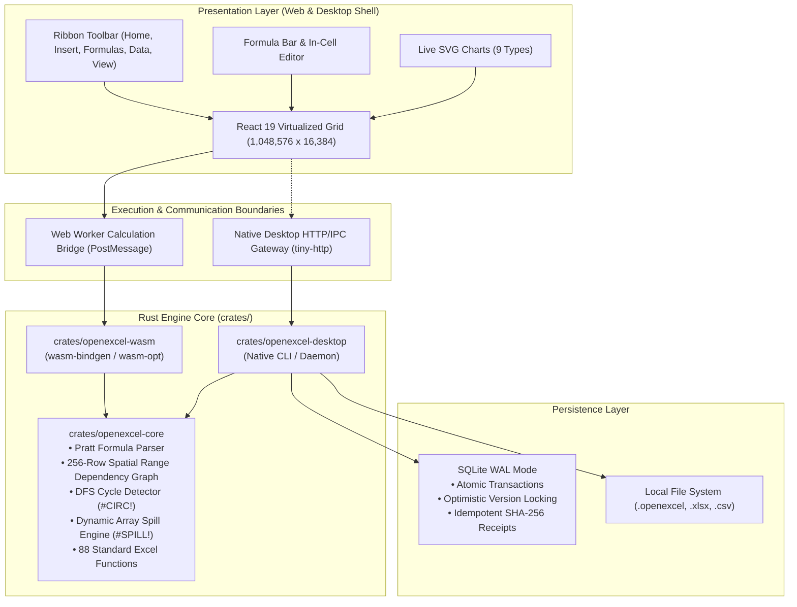

# OpenExcel System Architecture

## 1. Architectural Overview

OpenExcel is architected as a modular, high-performance hybrid spreadsheet platform combining a safe, high-speed **Rust core calculation engine** with an interactive **React single-page application**, compiled to both WebAssembly (for web clients) and native desktop binaries (with embedded SQLite WAL persistence).



---

## 2. Core Architectural Decisions

| Concern | Architectural Decision | Rationale |
|---|---|---|
| **Core Engine Language** | Pure Rust (`crates/openexcel-core`) | Uncompromising calculation speed, zero GC pauses, strict memory safety, and seamless compilation to native desktop and WebAssembly. |
| **Formula Parser** | Custom Pratt precedence parser | Allows operator precedence hierarchies (exponentiation right-associativity, unary minus, postfix percentage) and clean AST construction without grammar ambiguities. |
| **Dependency Graph** | Spatial Range Indexing (256-row buckets) + DFS Cycle Stack | Prevents creating millions of individual node edges for large rectangular references (e.g. `SUM(A1:A100000)`). Returns `#CIRC!` immediately without hanging or stack overflow. |
| **Dynamic Array Spills** | Matrix spill engine with collision detection | Dynamic formulas (such as `SEQUENCE(10, 5)`) spill across neighboring cells automatically, detecting collisions with authored cells and returning `#SPILL!`. |
| **Grid Virtualization** | Custom DOM virtualization with logarithmic coordinate lookup | Only renders the visible viewport (+ small overscan buffer) out of the 1,048,576 rows × 16,384 columns, maintaining smooth 60fps scrolling. |
| **Persistence Engine** | Bundled SQLite in WAL mode (`crates/openexcel-desktop`) | Atomic write transactions, `BEGIN IMMEDIATE`, optimistic version locking (`If-Match`), and idempotent SHA-256 receipts prevent data corruption. |
| **Distribution** | Dual Target: Native Desktop Binary + WASM Web Bundle | Complete flexibility: users can run standalone native desktop binaries or deploy zero-install web instances. |

---

## 3. Data Structures & Memory Model

### 3.1 Sparse 128x32 Tiling
Rather than allocating memory for 1,048,576 × 16,384 cells (over 17 billion potential cells), OpenExcel organizes cell storage into sparse tiles:
- **Tile Dimensions**: 128 rows by 32 columns.
- **Tile Key**: `tileRow:tileCol` (where `tileRow = floor(row / 128)`, `tileCol = floor(col / 32)`).
- **Cell Key**: `row:col`.
- **Memory Consumption**: Memory is only allocated for tiles that contain authored values, formulas, or formatting. An empty sheet consumes negligible memory.

### 3.2 Value Representation
Every cell value evaluates to a tagged union in Rust (`types.rs`):
```rust
pub enum Scalar {
    Null,
    Boolean { value: bool },
    Number { value: f64 },
    String { value: String },
    Error { code: ErrorCode, message: Option<String> },
}

pub enum ComputedValue {
    Array { rows: usize, cols: usize, values: Vec<Scalar> },
    Scalar(Scalar),
}
```

Standard Excel error values are strictly enumerated:
`#NULL!`, `#DIV/0!`, `#VALUE!`, `#REF!`, `#NAME?`, `#NUM!`, `#N/A`, `#SPILL!`, `#CALC!`, `#CIRC!`, `#PARSE!`.

---

## 4. Calculation Pipeline

The calculation cycle executes in 5 deterministic phases:

1. **Tokenization & Lexing**: Converts raw formula strings (e.g. `=SUM(Sheet1!A1:B10) * 10%`) into a stream of tokens, preserving quoted sheet identifiers, absolute `$A$1` reference flags, and number literals.
2. **Pratt Parsing**: Constructs a typed AST node tree according to precedence levels:
   - Level 2: Comparisons (`=`, `<>`, `<`, `<=`, `>`, `>=`)
   - Level 3: Concatenation (`&`)
   - Level 4: Addition & Subtraction (`+`, `-`)
   - Level 5: Multiplication & Division (`*`, `/`)
   - Level 7: Exponentiation (`^`, right-associative)
   - Level 8: Unary prefix (`+`, `-`), Postfix (`%`), Range (`:`)
3. **Dependency Graph Registration**:
   - Dependencies are tracked bidirectionally (`deps` and `reverse_deps`).
   - Range references are indexed into 256-row spatial buckets.
   - Cycle detection runs a depth-first traversal with an active recursion stack. If a cycle is detected, `#CIRC!` is assigned to cyclic nodes.
4. **Topological Evaluation**:
   - Dirty cells are sorted topologically so dependencies evaluate prior to dependents.
   - Recursive depth is avoided by linear stack processing, supporting chains deeper than 1,000 cells without stack overflow.
5. **Dynamic Array Spilling**:
   - If an expression evaluates to an `ArrayValue`, the target rectangle is checked for boundaries and collision with authored non-empty cells.
   - Collisions trigger `#SPILL!`; successful allocations register child references.

---

## 5. Security & Resource Boundaries

- **Sandboxed Execution**: Formula evaluation is executed entirely within pure Rust/WASM logic. Arbitrary JavaScript or system code execution is impossible.
- **Resource Limits**:
  - Max Sheets: 256
  - Max Authored Cells: 2,000,000
  - Max Formula Length: 32,768 characters
  - Max AST Depth: 1,024
  - Max Evaluation Steps: 50,000,000
  - Max Calculation Time: 30,000 ms
  - Max Lambda Recursion Depth: 256
- **Untrusted File Input**: XLSX and CSV imports are treated as untrusted data, validating dimensions and formula lengths before parsing.
