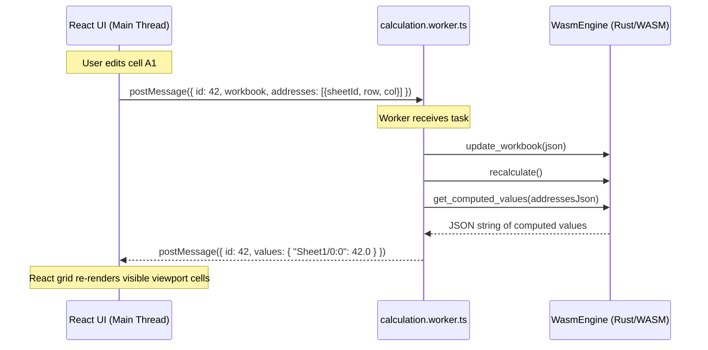
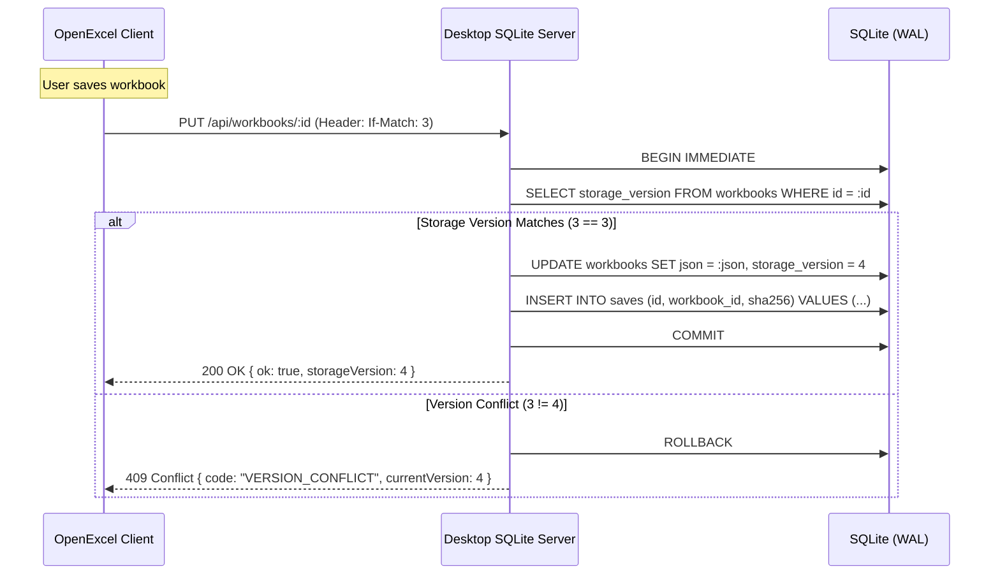

# OpenExcel Runtime Architecture

## 1. Runtime Modes

OpenExcel supports two primary execution topologies sharing the same underlying Rust calculation engine:

### 1.1 Native Desktop Runtime
In desktop mode, [`crates/openexcel-desktop`](file:///workspaces/excellence-chart/crates/openexcel-desktop) serves as a standalone runner:
- **Embedded Web Server**: Uses `tiny-http` to host static web assets (`dist-release/web`) and provide JSON REST endpoints under `/api/workbooks`.
- **Bundled SQLite Engine**: Direct C-bindings (`rusqlite` bundled) executing WAL mode journaling with `synchronous = FULL` and a 5,000 ms busy timeout.
- **Local File System Access**: Native commands to open and save `.openexcel` and `.xlsx` files without browser sandbox restrictions.

### 1.2 Web & WebAssembly Runtime
In web mode, [`crates/openexcel-wasm`](file:///workspaces/excellence-chart/crates/openexcel-wasm) is loaded inside a dedicated Web Worker:
- **Non-Blocking Recalculation**: Web Worker processes calculation off the main thread, ensuring the DOM virtualized grid maintains smooth 60fps scrolling during heavy recomputation.
- **`wasm-bindgen` Memory Bridge**: High-speed memory copying between JavaScript TypedArrays and WebAssembly linear memory.

---

## 2. Web Worker Communication Protocol

### Protocol Invariants
1. **Asynchronous Evaluation**: The UI thread never calls calculation synchronously. Long calculations never cause UI freezing.
2. **Viewport Bounded Queries**: The UI requests calculated values only for cells currently visible in the virtualized viewport plus active chart ranges.
3. **Cancellation & Sequencing**: Each calculate request carries an incrementing request ID. Stale responses are discarded if a newer snapshot has been submitted.

---

## 3. Persistence & Concurrency Protocol

### Concurrency Guarantees
- **Optimistic Concurrency**: Prevents accidental overwrites across multiple browser tabs or concurrent sessions.
- **WAL Journaling**: Readers do not block writers; writers do not block readers.
- **Idempotent Saves**: Hash of snapshot payload prevents duplicate save history entries.
