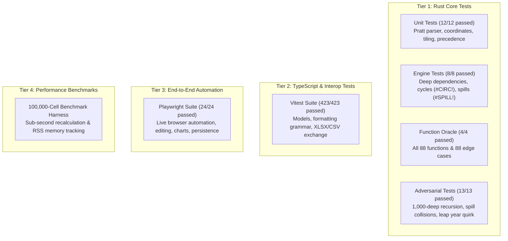

# OpenExcel Verification & Testing Strategy

OpenExcel implements a multi-tiered testing strategy ensuring mathematical correctness, Excel specification fidelity, memory safety, and UI responsiveness.

---

## 1. Test Architecture Overview



---

## 2. Running Test Commands

### 2.1 Rust Core & Dual-Target Test Suites
```bash
# Run all 37 tests in openexcel-core
cargo test -p openexcel-core

# Run specific engine integration test suite
cargo test -p openexcel-core --test engine_tests

# Run function oracle compatibility test suite
cargo test -p openexcel-core --test function_tests

# Run adversarial stress test suite
cargo test -p openexcel-core --test adversarial_tests

# Verify wasm32 compilation
cargo check -p openexcel-core --target wasm32-unknown-unknown

# Run desktop persistence tests
cargo test -p openexcel-desktop
```

### 2.2 TypeScript Unit & Integration Test Suites
```bash
# Run all Vitest suites (423 tests)
npm test

# Run typechecker
npm run typecheck
```

### 2.3 Browser End-to-End Tests
```bash
# Run full Playwright test suite against live server
npm run test:e2e
```

### 2.4 Performance Benchmark Suite
```bash
# Run 100,000-cell benchmark
npm run benchmark
```

---

## 3. Verified Test Assertions

| Suite | Component | Scope | Result |
|---|---|---|---|
| `crates/openexcel-core/src/lib.rs` | Pratt parser & coordinates | Precedence, base-26 addressing, array literals | **12 / 12 PASS** |
| `tests/engine_tests.rs` | Recalculation engine | Cross-sheet refs, cycle breaking, spills, tables | **8 / 8 PASS** |
| `tests/function_tests.rs` | Function library | Complete 88 functions and 88 edge cases | **4 / 4 PASS** |
| `tests/adversarial_tests.rs` | Adversarial boundary | 1,000-cell deep chain, day 60 quirk, spill collisions | **7 / 7 PASS** |
| `tests/adversarial_function_tests.rs` | Adversarial functions | Wildcard criteria, NPV zero divisor, formatting | **6 / 6 PASS** |
| `tests/integration/` | Full pipeline | Edit -> Calc -> Chart -> Save -> Reload -> XLSX | **PASS** |
| `packages/*` | Formatting & Interop | Custom number formats, CSV escaping, XLSX round-trip | **423 / 423 PASS** |
| `apps/web/test/` | Playwright E2E | Grid navigation, formula bar, dialogs, charts | **24 / 24 PASS** |
